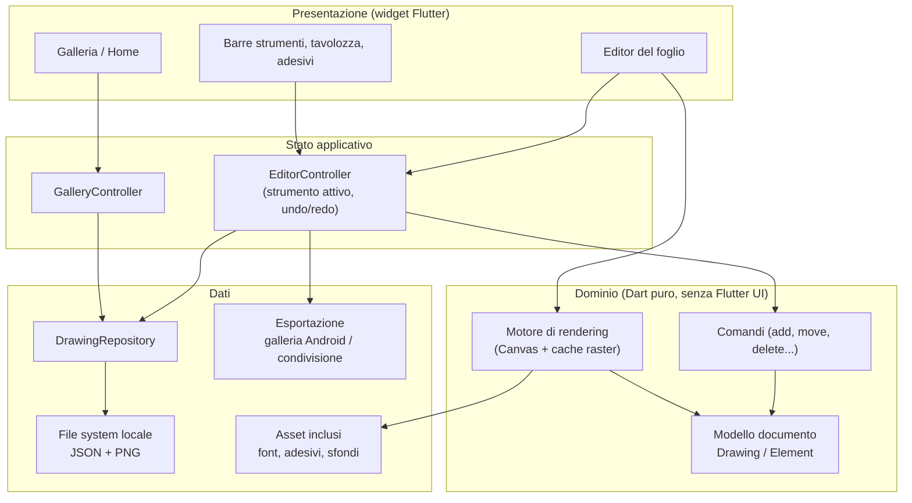

# 01 — Analisi architetturale

- **Stato:** ✅ approvata — tutte le decisioni AD-01…AD-17 e D-01…D-10 chiuse il 2026-10-24
- **Ultimo aggiornamento:** 2026-10-24
- **Nome dell'app:** *Pastello* — package Android `io.github.pegperego.pastello`
- **Repository:** `github.com/pegperego/pastello-app`

> Ogni decisione è identificata da un codice `AD-xx`. Quando una decisione viene
> approvata, la riportiamo in inglese come ADR in `docs/adr/`.
> Stati possibili: **proposta** → **approvata** / **scartata**.

---

## 1. Scopo del documento

Definire le scelte tecniche di fondo **prima** di scrivere codice, in modo che:

- l'app sia veloce e affidabile sul tablet (una bambina non perdona il lag né
  un disegno perso);
- il progetto possa crescere con contributi esterni senza diventare caotico;
- i vincoli (offline, privacy, open source) siano garantiti dall'architettura e
  non solo dalla buona volontà.

L'analisi funzionale (`02-analisi-funzionale.md`) dettaglierà poi cosa fa
l'app; qui ci limitiamo alle funzioni già note, che bastano a dimensionare
l'architettura:

1. disegno a mano libera;
2. scritte sul foglio;
3. galleria dei disegni (salva, riapri, continua, esporta);
4. sfondi, adesivi, forme (ed eventualmente disegni da colorare).

## 2. Contesto e vincoli

| Vincolo | Origine | Conseguenza architetturale |
|---|---|---|
| Utente principale: bambina di 8 anni | Requisito | UI a icone, target touch grandi, nessuna azione irreversibile, autosalvataggio |
| Tablet Android (dito e forse penna) | Requisito | Layout per schermi grandi, orizzontale e verticale, gestione input penna |
| Flutter | Scelta iniziale | Rendering custom su `Canvas`, un solo codebase Dart |
| Offline first | Requisito | Nessun backend; dati solo locali; risorse incluse nell'APK |
| Open source, community GitHub | Requisito | Licenza GPL-3.0, dipendenze libere, documentazione e test curati |
| Codice e doc in inglese, analisi in italiano | Requisito | `docs/` in EN, `analisi/` in IT |

### Offline *first* o offline *only*?

"Offline first" di solito indica un'app che funziona offline e sincronizza
quando c'è rete. Qui non c'è nulla da sincronizzare, quindi proponiamo il passo
successivo: **offline only**. L'app **non richiede il permesso `INTERNET`**.
Questo:

- elimina alla radice ogni rischio di tracciamento o contenuti esterni;
- è verificabile da chiunque (basta guardare il manifest);
- semplifica la pubblicazione su F-Droid e un'eventuale pubblicazione su Play
  nel programma per famiglie.

Un'eccezione già prevista per il futuro è il **catalogo aggiornabile** (nuovi
adesivi, sfondi, disegni da colorare): non fa parte della prima versione, ma
l'architettura è predisposta per aggiungerlo senza riscritture (vedi AD-17).

## 3. Requisiti non funzionali (attributi di qualità)

| ID | Attributo | Obiettivo misurabile |
|---|---|---|
| NFR-01 | Reattività del tratto | Il tratto segue il dito senza ritardo percepibile; frame rate pieno del display (90 Hz sul tablet di riferimento) anche con centinaia di tratti |
| NFR-02 | Affidabilità | Nessun disegno perso: autosalvataggio continuo, anche se l'app viene chiusa o il tablet si spegne |
| NFR-03 | Avvio | App pronta a disegnare in < 2 s sul tablet di riferimento (fascia media-bassa) |
| NFR-04 | Semplicità d'uso | Ogni funzione principale raggiungibile con al massimo 2 tocchi, senza leggere |
| NFR-05 | Privacy | Zero dati in uscita dal dispositivo senza un'azione esplicita di un adulto |
| NFR-06 | Manutenibilità | Codice testato (copertura ≥ 90% motore, ≥ 70% logica app; AD-14), analisi statica pulita, architettura documentata |
| NFR-07 | Portabilità dei dati | Formato dei disegni aperto, documentato e versionato |
| NFR-08 | Dimensione | APK contenuto (indicativamente < 30 MB) nonostante font e adesivi inclusi |

## 4. Vista d'insieme

Architettura a strati, organizzata per funzionalità (*feature-first*):



Regola d'oro: **il dominio non dipende dalla UI né dal file system**. Così il
modello del disegno e i comandi si testano con semplici unit test.

## 5. Decisioni architetturali

### AD-01 — Flutter, Android, pensata per tablet

- **Stato:** ✅ approvata (2026-10-24) → [ADR 0002](../docs/adr/0002-flutter-android-tablet-first.md)
- **Decisione:**
  - Flutter stabile (oggi 3.44 / Dart 3.12); la versione esatta è fissata nel
    progetto e nella CI, così tutti compilano con la stessa;
  - solo Android, versione minima **Android 10 (API 29)** (D-04);
  - interfaccia **pensata per tablet** ma **installabile anche su smartphone**
    (funziona, senza ottimizzazioni specifiche);
  - **entrambe le orientazioni**: il foglio mantiene la sua forma (D-05), le
    barre degli strumenti si riposizionano;
  - **pulsante rapido "blocca rotazione"** sempre visibile nell'editor: fissa
    l'orientamento corrente (utile quando la bambina tiene il tablet in
    mano o sulle gambe). Si implementa in Dart con
    `SystemChrome.setPreferredOrientations`, senza codice nativo; la scelta
    viene ricordata tra una sessione e l'altra.
- **Motivazione:** il rendering di Flutter (Impeller) disegna direttamente su
  canvas GPU, ideale per un'app di disegno; codebase unico e popolare per i
  contributori.
- **Nota:** evitiamo codice nativo Android dove non serve, così un futuro porting
  (iPad, desktop, Linux) resta economico.

### AD-02 — Offline only, nessun permesso di rete

- **Stato:** ✅ approvata (2026-10-24) → [ADR 0003](../docs/adr/0003-offline-only-no-data-collection.md)
- **Decisione:**
  - nessun permesso `INTERNET` nel manifest di release (Flutter lo aggiunge
    solo ai manifest di debug/profile per l'hot reload: va lasciato lì);
  - font, adesivi e sfondi **inclusi negli asset** (niente `google_fonts` a
    runtime, niente immagini scaricate);
  - nessun SDK di analytics, crash reporting, pubblicità;
  - un test in CI verifica che il manifest di release non contenga permessi di
    rete (finché non arriva il catalogo online; da quel momento il test
    verificherà che `INTERNET` sia l'**unico** permesso di rete e che non ce ne
    siano altri inattesi);
  - pagina **"Informazioni"** (dietro il cancello genitori, D-08) con versione
    dell'app, modello del dispositivo e versione di Android, più un pulsante
    **"Copia informazioni per la segnalazione"**: l'adulto le incolla in una
    issue. Nessun dato parte in automatico.
- **Motivazione:** privacy di una minore, semplicità, conformità F-Droid.
- **Evoluzione prevista:** il catalogo scaricabile (AD-17) sarà l'unico punto
  in cui l'app potrà usare la rete, in una fase successiva.

### AD-17 — Catalogo di contenuti a "pacchetti", predisposto per l'aggiornamento

- **Stato:** ✅ approvata (2026-10-24) → [ADR 0018](../docs/adr/0018-content-packs.md)
- **Contesto:** in futuro può essere utile aggiornare il catalogo (adesivi,
  sfondi, disegni da colorare, font) senza pubblicare una nuova versione
  dell'app. Nella prima versione però restiamo senza rete.
- **Decisione:** fin da subito i contenuti sono organizzati in **pacchetti**
  con un manifest, invece di essere "cablati" nel codice:

```text
pack/
├── pack.json        # id, versione, titolo (it/en), autore, licenza, elenco elementi
├── stickers/*.svg
├── backgrounds/*.svg|png
└── coloring/*.svg
```

  - L'app legge i pacchetti tramite un'interfaccia `ContentCatalog` con più
    sorgenti: nella v1 solo **`BundledSource`** (pacchetti inclusi negli
    asset); più avanti si aggiunge una **`RemoteSource`** che scarica pacchetti
    e li salva in locale.
  - I disegni salvati fanno riferimento agli elementi con `packId/elementId`:
    un disegno resta valido anche se il pacchetto viene aggiornato.
  - Ogni pacchetto dichiara la propria **licenza e attribuzione**: la schermata
    "Crediti" si genera dai manifest.
  - **Contenuto mancante:** se un disegno usa un elemento di un pacchetto non
    installato, al suo posto si mostra un **segnaposto** ("?") con stessa
    posizione e dimensione. Il riferimento resta nel file: se il pacchetto
    torna disponibile, l'elemento ricompare.
- **Quando arriverà la parte online (D-10):**
  - anche con il catalogo online l'app resta **pienamente utilizzabile
    offline**: i pacchetti scaricati restano sul dispositivo;
  - il download lo avvia un adulto (dietro il "cancello genitori"), mai in
    automatico, senza account né dati inviati oltre la richiesta del file;
  - il catalogo è ospitato in un **repository GitHub separato**,
    `pegperego/pastello-catalog` (release o GitHub Pages): pubblico, libero e
    gratuito; chiunque può verificarlo o proporre nuovi contenuti con una pull
    request;
  - pacchetti firmati o con checksum, per non caricare contenuti alterati;
  - **una sola versione dell'app**: da quel momento l'app chiederà il permesso
    `INTERNET`, usato esclusivamente per scaricare il catalogo. Il servizio è
    libero (GitHub, contenuti aperti), compatibile con i criteri F-Droid;
  - i principi in `README.md` e `CONTRIBUTING.md` ("offline only") andranno
    aggiornati in "offline first: la rete serve solo per il catalogo,
    su richiesta di un adulto";
  - **Importazione di un pacchetto da file** (`.zip` copiato sul tablet,
    senza rete): **dopo la v1, insieme al catalogo online**, perché condivide
    la stessa logica di installazione e verifica.

### AD-03 — Modello del documento vettoriale

- **Stato:** ✅ approvata (2026-10-24) → [ADR 0004](../docs/adr/0004-vector-document-model.md)
- **Decisione:** un disegno è una **lista ordinata di elementi** (non una
  bitmap). La bitmap si genera solo per visualizzare e per esportare.

```text
Drawing
├── id, title, createdAt, updatedAt, schemaVersion
├── sheet: { width, height, background }     # dimensione logica fissa
└── elements: [Element]                       # ordine = profondità (z-order)
    │   (ogni elemento ha: id, transform { traslazione, scala, rotazione })
    ├── StrokeElement   { tool, color, width, points[x, y, pressure], erasures[] }
    ├── TextElement     { text, font, size, color }
    ├── StickerElement  { packId, elementId }
    ├── ShapeElement    { kind, size, stroke, fill }
    └── FillElement     { mask PNG, color }   # secchiello, dopo la v1 (D-06)
```

- **Dimensione del foglio fissa** (D-05): presa dalle proporzioni dello
  schermo alla creazione e salvata in `sheet`; ruotando il tablet il foglio
  non si deforma ma viene adattato allo spazio disponibile.
  **Precisazione (prototipo, 2026-10-24):** finché il foglio è vuoto (e non
  c'è nulla da annullare) segue la forma dello schermo; la forma si fissa al
  primo tratto. All'avvio Android può mostrare l'app per un istante in
  verticale prima di ruotarla: senza questa regola il foglio nascerebbe
  verticale e apparirebbe piccolo in orizzontale.
- **Coordinate in unità del foglio**, non in pixel dello schermo: il disegno
  appare identico su tablet diversi e a qualsiasi risoluzione di esportazione.
- **Ogni elemento ha una `transform`** (posizione, scala, rotazione): spostare
  o ingrandire qualcosa non riscrive i suoi punti, cambia solo la transform.
- **Cosa si può toccare e spostare:**
  - **scritte, adesivi, forme:** sì, direttamente con il dito (sposta,
    ingrandisci, ruota, elimina) **quando lo strumento attivo è testo,
    adesivi, forme o Seleziona**; con gli strumenti di disegno il tocco
    disegna sopra, come sulla carta (precisato in F-07);
  - **tratti a mano libera:** no con il tocco normale, restano "inchiostro sul
    foglio";
  - **strumento "Seleziona"** dedicato: si attiva dalla barra, si disegna un
    **lazo** attorno a una parte del disegno e la si sposta/ingrandisce/ruota/
    elimina. Funziona su **tutti** gli elementi, tratti compresi. Così il tocco
    normale resta non ambiguo (disegna) e chi vuole riorganizzare il foglio ha
    uno strumento apposito. Priorità (v1 o dopo) da definire nell'analisi
    funzionale; il modello lo supporta fin da subito.
- **Interazione con la gomma:** se un tratto cancellato in parte viene poi
  spostato, la parte cancellata deve spostarsi con lui. Per questo le
  cancellature sono memorizzate **sul tratto** (`erasures`), non come
  "buchi" globali nel foglio → dettagli in AD-05.
- **Motivazione:**
  - le scritte, gli adesivi e le forme restano **spostabili e modificabili**
    anche dopo (requisito naturale per "mettere scritte sul foglio");
  - lo strumento Seleziona permette di correggere la composizione senza
    ridisegnare;
  - undo/redo semplice e leggero;
  - file piccoli, esportabili a qualsiasi risoluzione.
- **Contro:** un disegno con migliaia di tratti va ridisegnato in modo furbo →
  vedi AD-04.

### AD-04 — Motore di disegno proprietario del progetto, con cache raster

- **Stato:** ✅ approvata e **confermata dal prototipo** (2026-10-24, vedi
  [risultati](risorse/prototipo-risultati.md)) → [ADR 0005](../docs/adr/0005-in-house-drawing-engine.md)
- **Opzioni valutate:**

| Opzione | Pro | Contro |
|---|---|---|
| A. Pacchetto "drawing board" già pronto | Veloce da partire | Difficile da personalizzare per bambini; modello dati imposto; manutenzione esterna incerta |
| B. **Motore proprio su `CustomPainter`** | Controllo totale su prestazioni, aspetto e formato | Più codice da scrivere e testare |

- **Decisione:** opzione **B**, **non negoziabile**: il motore di disegno è
  il cuore dell'app e resta sviluppato dal progetto. Se il prototipo mostra
  problemi di prestazioni, si **ottimizza il nostro motore**, non si passa a
  un pacchetto esterno.
  - Il **tratto in corso** viene disegnato live da un painter dedicato.
  - I **tratti completati** vengono "appiattiti" in un'immagine di cache
    (`Picture` → `ui.Image`), ridisegnata solo quando cambia il documento.
    Il costo per frame resta costante anche con molti tratti.
  - Separazione in **livelli fissi**: sfondo → disegno → elementi (testi,
    adesivi, forme) → interfaccia di selezione. Ogni livello in un
    `RepaintBoundary`.
  - Durante lo **strumento Seleziona** gli elementi selezionati escono
    temporaneamente dalla cache e vengono disegnati sopra mentre si muovono.
  - Forma del tratto morbida (spessore variabile con velocità/pressione):
    algoritmo da scegliere in AD-13 (libreria `perfect_freehand` oppure
    implementazione nostra dello stesso approccio).
- **Ottimizzazioni previste se servono** (in ordine di semplicità):
  1. aggiornamento **incrementale** della cache: un tratto nuovo si disegna
     sopra l'immagine esistente invece di ricostruirla tutta;
  2. **semplificazione dei punti** del tratto a fine disegno (es.
     Ramer–Douglas–Peucker), meno punti da salvare e ridisegnare;
  3. **cache a tessere** (tile): si ridisegna solo la zona del foglio cambiata;
  4. **snapshot periodici** della cache per rendere undo/redo istantanei;
  5. salvataggio/serializzazione in un **isolate** separato, per non
     disturbare il disegno.

### AD-05 — Gomma "a pixel" legata ai tratti, che non cancella lo sfondo

- **Stato:** ✅ approvata (2026-10-24) → [ADR 0006](../docs/adr/0006-stroke-attached-eraser.md)
- **Decisione:** la gomma si comporta come una **gomma vera**: cancella dove
  passa, non elimina il tratto intero, e **non cancella mai lo sfondo** (righe,
  quadretti, disegno da colorare).
  - Quando il dito si alza, il percorso della gomma (con il suo spessore)
    viene **associato a ogni tratto che interseca**, salvato in `erasures`
    nelle coordinate locali del tratto (cioè applicando l'inversa della sua
    `transform`).
  - In rendering, un tratto con cancellature si disegna in un `saveLayer`:
    prima il tratto, poi le cancellature con `BlendMode.clear`. I tratti senza
    cancellature (la maggior parte) non hanno costi aggiuntivi; tutto finisce
    comunque nella cache raster (AD-04).
  - Se il tratto viene spostato/ruotato con lo strumento Seleziona, le
    cancellature lo seguono.
  - I tratti disegnati **dopo** non sono toccati da cancellature precedenti.
  - Annulla rimuove la cancellatura da tutti i tratti a cui era associata
    (un solo comando, AD-06).
- **Scritte, adesivi e forme non vengono cancellati dalla gomma.** Si
  eliminano trascinandoli sul **cestino**, con la "x" dell'elemento
  selezionato o con lo strumento Seleziona. C'è inoltre **"Pulisci foglio"**,
  annullabile.
- **Evoluzione possibile:** una funzione "**trasforma in disegno**" per
  scritte (e forse adesivi), che li converte in un elemento grafico non più
  modificabile come testo ma cancellabile con la gomma. Per non precludere
  questa strada, nel codice le `erasures` sono una capacità generica
  dell'elemento (non specifica di `StrokeElement`), abilitata per ora solo sui
  tratti.

### AD-06 — Undo/redo con pattern Command, cronologia salvata con il disegno

- **Stato:** ✅ approvata (2026-10-24) → [ADR 0007](../docs/adr/0007-persistent-undo-history.md)
- **Decisione:**
  - ogni modifica è un **comando reversibile e serializzabile** (`AddElement`,
    `EraseStrokes`, `TransformElements`, `ChangeStyle`, `DeleteElements`,
    `ClearSheet`...); il controller mantiene due pile (annulla/ripeti) con un
    limite di **100 passi**;
  - un gesto continuo (es. trascinare un adesivo) produce **un solo** comando;
  - anche **"Pulisci foglio"** è annullabile;
  - la **cronologia si salva con il disegno**: riaprendo un disegno dalla
    galleria si può ancora annullare/ripetere.
- **Come si salva:**
  - in un file separato `history.json` accanto a `drawing.json` (AD-09):
    `drawing.json` resta la **fonte di verità** pulita e documentata, la
    cronologia è un "di più";
  - `history.json` contiene le due pile e un riferimento alla **revisione**
    di `drawing.json` a cui si applica; se non corrispondono (es. salvataggio
    interrotto a metà) la cronologia viene scartata e il disegno resta
    intatto: si perde al massimo la possibilità di annullare, mai il disegno;
  - se il formato cambia (`schemaVersion`) e la cronologia non è migrabile,
    viene scartata con la stessa logica;
  - la cronologia **non** viene inclusa nelle esportazioni né copiata quando si
    duplica un disegno.
- **Motivazione:** "annulla" è il salvagente di un bambino, anche il giorno
  dopo.
- **Costo:** file un po' più grandi (con 100 passi resta contenuto: un
  "Pulisci foglio" è il caso peggiore perché conserva gli elementi rimossi) e
  comandi da serializzare e testare.

### AD-07 — Gestione dell'input (dito, penna, palmo)

- **Stato:** ✅ approvata (2026-10-24) → [ADR 0008](../docs/adr/0008-touch-input-handling.md)
- **Decisione:**
  - si usa la `PointerEvent` di Flutter, che distingue `touch` / `stylus` e
    fornisce la pressione;
  - **un dito disegna** con lo strumento attivo; nella v1 **niente
    zoom/spostamento** del foglio (D-07). Le coordinate del foglio sono già
    separate da quelle dello schermo, quindi lo zoom si potrà aggiungere in
    seguito;
  - **vince il primo dito**: altri puntatori (secondo dito, palmo) appoggiati
    mentre si disegna vengono ignorati;
  - un **tocco singolo lascia un puntino**;
  - **nessuna gesture multi-dito** nella v1 (es. due dita = annulla): annulla e
    ripeti sono pulsanti grandi e sempre visibili. Eventuali gesture in futuro,
    come opzione disattivata di default;
  - **spessore:** l'utente sceglie uno **spessore di partenza** con un
    selettore (pochi spessori predefiniti, mostrati come pallini di diversa
    grandezza); la **velocità** del tratto lo modula attorno a quel valore,
    visto che il dito non fornisce pressione. Quali strumenti usano lo
    spessore variabile (pennello) e quali costante (matita, pennarello) si
    decide nell'analisi funzionale;
  - **penna rinviata a dopo la v1:** il codice distingue già `touch` /
    `stylus`, così in futuro si potranno aggiungere pressione reale e
    modalità "solo penna" con palm rejection senza riprogettare.
  - Una **penna capacitiva** economica (punta in gomma) per l'app è
    equivalente a un dito: funziona già dalla v1.

### AD-08 — Gestione dello stato: Riverpod

- **Stato:** ✅ approvata (2026-10-24) → [ADR 0009](../docs/adr/0009-riverpod-state-management.md)
- **Opzioni:** `ChangeNotifier`/`provider`, **Riverpod**, Bloc.
- **Decisione:** **Riverpod senza generazione di codice**, per abbassare la
  barriera d'ingresso ai contributori.
- **Motivazione:** dependency injection integrata (comodo per sostituire il
  repository nei test), stato immutabile, molto diffuso nella community
  Flutter.
- **Eccezione per le prestazioni:** il tratto in corso **non passa** da
  Riverpod: il painter ascolta direttamente un `ChangeNotifier` locale, per non
  ricostruire widget a ogni movimento del dito. Riverpod gestisce tutto il
  resto (strumento, colore, spessore, cronologia, galleria).

### AD-09 — Persistenza su file, senza database

- **Stato:** ✅ approvata (2026-10-24) → [ADR 0010](../docs/adr/0010-file-based-storage.md)
- **Decisione:** nella cartella privata dell'app:

```text
<app documents>/
├── trash/               # disegni eliminati, stessa struttura, con data di eliminazione
└── drawings/
    └── <uuid>/
        ├── drawing.json     # il documento (AD-03), con schemaVersion
        ├── history.json     # cronologia annulla/ripeti (AD-06)
        ├── thumbnail.png    # miniatura per la galleria
        └── fills/           # eventuali maschere del secchiello
```

- **Autosalvataggio** con debounce (es. 1–2 s dopo l'ultima modifica) e
  sempre quando l'app va in background (`AppLifecycleState.paused`).
- **Scrittura atomica:** si scrive un file temporaneo e lo si rinomina, così
  un'interruzione non corrompe il disegno.
- **Migrazioni:** `schemaVersion` permette di aggiornare i file vecchi quando il
  formato evolve.
- **Perché non un database:** pochi disegni (decine/centinaia), struttura
  semplice; i file sono ispezionabili, facili da salvare e da documentare.
  Se la galleria diventasse lenta si può aggiungere un indice in un secondo
  momento.
- La cartella privata non richiede permessi di storage.
- **Cestino:** eliminare un disegno lo **sposta** in `trash/` (operazione
  istantanea e reversibile). I disegni nel cestino si possono ripristinare per
  **30 giorni**, poi vengono eliminati automaticamente all'avvio dell'app.
  Svuotare il cestino manualmente richiede il cancello genitori (D-08).
- **Backup:**
  - **backup cloud di Android disattivato** (i disegni non finiscono
    sull'account Google);
  - **trasferimento diretto tra dispositivi consentito** (da tablet vecchio a
    nuovo, senza cloud), tramite le regole `dataExtractionRules` del manifest;
  - più avanti, nella pagina genitori: **"Esporta tutti i disegni"** in un
    file `.zip` e **"Importa"** per ripristinarli. Il formato dello zip è la
    stessa struttura di cartelle documentata.

### AD-10 — Esportazione, condivisione e stampa

- **Stato:** ✅ approvata (2026-10-24) → [ADR 0011](../docs/adr/0011-export-share-print.md)
- **Decisione:**
  - **Esporta come immagine** PNG nella galleria del tablet tramite MediaStore
    (da Android 10, la nostra versione minima, non serve alcun permesso di
    scrittura sulla memoria). Risoluzione = **risoluzione nativa dello schermo**
    nell'orientamento del foglio (sul Redmi Pad 2 circa 2560×1600). Il modello
    vettoriale permetterà in futuro un'opzione "alta qualità";
  - **esportare in galleria è libero**: il disegno resta sul tablet, la
    bambina può salvare da sola i suoi lavori;
  - **condividere** usa il menu di sistema di Android (intent) e passa dal
    **"cancello genitori"** (D-08), perché porta il contenuto fuori dal
    dispositivo: un'addizione a due cifre con numeri casuali (es. "34 + 47"),
    da risolvere con un tastierino numerico. Un componente riutilizzabile
    `ParentalGate`, che servirà anche per il download dei pacchetti (AD-17);
  - **stampa nella v1**: pulsante "Stampa" che apre il sistema di stampa di
    Android (stampante di casa o "Salva come PDF"), tramite la libreria
    `printing` (Apache-2.0, da verificare in AD-13). Il foglio viene adattato
    alla pagina mantenendo le proporzioni. **Libera**, senza cancello
    genitori: la stampa resta in casa. La stampa passa dal servizio di stampa
    di Android, quindi l'app non ha bisogno del permesso `INTERNET`; il
    controllo del manifest in CI (AD-02) lo garantisce.

### AD-11 — Organizzazione del codice: workspace con app e motore separati

- **Stato:** ✅ approvata (2026-10-24) → [ADR 0012](../docs/adr/0012-workspace-app-and-engine.md)
- **Decisione:** un **workspace Dart** (pub workspaces) con due pacchetti:

```text
pastello/
├── pubspec.yaml                  # workspace root
├── app/                          # l'app Flutter
│   ├── lib/
│   │   ├── main.dart
│   │   └── src/
│   │       ├── app/              # MaterialApp, tema, routing
│   │       ├── core/             # utilità comuni (file system, errori, log)
│   │       ├── l10n/             # traduzioni ARB
│   │       └── features/         # una cartella per funzionalità
│   │           ├── editor/       # schermata editor, barre strumenti, stato
│   │           ├── gallery/      # galleria e cestino
│   │           ├── stickers/     # catalogo e pacchetti (AD-17)
│   │           ├── export/       # galleria, condivisione, stampa
│   │           └── parents/      # cancello genitori, informazioni, backup
│   ├── test/                     # stessa struttura di lib/src
│   └── android/
├── packages/
│   └── pastello_engine/          # il nostro motore di disegno
│       ├── lib/src/
│       │   ├── document/         # Drawing, Element, serializzazione, migrazioni
│       │   ├── commands/         # comandi annulla/ripeti
│       │   ├── geometry/         # tratti, gomma, hit-test, lazo
│       │   └── rendering/        # painter, cache raster
│       ├── test/                 # unit e golden test
│       └── benchmark/            # banco di prova delle prestazioni
├── docs/
└── analisi/
```

- **Regole:**
  - `pastello_engine` **non dipende dall'app** né da Riverpod, file system o
    plugin: solo Dart e `dart:ui`/Flutter per il rendering. La regola è
    garantita dal compilatore;
  - dentro l'app, ogni funzionalità è autonoma; il codice condiviso va in
    `core/`.
- **Motivazione:** confini chiari e verificabili, motore testabile e
  misurabile in isolamento, possibilità di riuso in altri progetti.

### AD-12 — Lingue: italiano e inglese dal giorno uno

- **Stato:** ✅ approvata (2026-10-24) → [ADR 0013](../docs/adr/0013-localization-and-keyboard-privacy.md)
- **Decisione:**
  - localizzazione ufficiale Flutter (`flutter_localizations` + file ARB),
    **italiano e inglese** dalla v1; nuove lingue aggiungibili dalla
    community con un file ARB;
  - la lingua **segue quella del sistema**, con **inglese** come ripiego; nella
    pagina genitori si può **forzare una lingua**;
  - l'interfaccia usa **pochissimo testo**: icone grandi e colori; il testo è
    concentrato nella pagina genitori;
  - **privacy della tastiera:** tutti i campi di testo usano
    `enableIMEPersonalizedLearning: false` (modalità "incognito": la tastiera
    non memorizza né impara ciò che la bambina scrive). Correzione automatica
    e suggerimenti restano attivi.

### AD-13 — Politica delle dipendenze

- **Stato:** ✅ approvata (2026-10-24) → [ADR 0014](../docs/adr/0014-dependency-policy.md)
- **Regole:**
  1. solo licenze compatibili con GPL-3.0 (MIT, BSD, Apache-2.0, OFL per i
     font, CC-BY / CC-BY-SA per le immagini, con attribuzione);
  2. niente Google Play Services, Firebase, SDK proprietari (requisito
     F-Droid);
  3. preferire pacchetti mantenuti e con pochi transitivi; ogni nuova
     dipendenza va motivata nella PR;
  4. una schermata "Crediti/Licenze" nell'app (`showLicensePage` + attribuzioni
     degli asset);
  5. **`pastello_engine` non ha dipendenze esterne** (solo SDK Dart/Flutter).
- **Dipendenze approvate** (verificate su pub.dev il 2026-10-24):

| Esigenza | Pacchetto | Versione | Licenza |
|---|---|---|---|
| Stato (AD-08) | `flutter_riverpod` | 3.4.3 | MIT |
| Percorsi app | `path_provider` | 2.1.6 | BSD-3 |
| Salvataggio in galleria | `gal` | 2.3.3 | BSD-3 |
| Condivisione | `share_plus` | 13.3.1 | BSD-3 |
| Stampa (AD-10) | `printing` | 5.15.1 | Apache-2.0 |
| Adesivi vettoriali | `flutter_svg` | 2.3.0 | MIT |
| Pagina Informazioni (AD-02) | `package_info_plus`, `device_info_plus` | 10.2.2 / 13.3.0 | BSD-3 |
| Link della pagina genitori (aggiunta 2026-10-25) | `url_launcher` | 6.3.3 | BSD-3 |
| Lint (solo sviluppo) | `flutter_lints` | 6.0.0 | BSD-3 |

- **Scartate di proposito:**
  - `uuid` → ID casuali generati con `Random.secure()` (poche righe);
  - `shared_preferences` → impostazioni in `settings.json`, con la stessa
    scrittura atomica dei disegni (AD-09);
  - `perfect_freehand` → **algoritmo della forma del tratto implementato nel
    motore**, ispirato a perfect_freehand (MIT, citato nei crediti e nel
    codice): regolabile per i bambini e integrato con gomma e semplificazione.
- **Asset (da scegliere nell'analisi funzionale):**

| Risorsa | Licenza |
|---|---|
| Font Andika, Atkinson Hyperlegible, Comic Neue | SIL OFL 1.1 |
| Adesivi OpenMoji o set disegnati da noi | CC BY-SA 4.0 / da definire |

### AD-14 — Qualità e processo

- **Stato:** ✅ approvata (2026-10-24) → [ADR 0015](../docs/adr/0015-quality-and-workflow.md)
- **Decisione:**
  - lint: `flutter_lints` + alcune regole più severe; `dart format`
    obbligatorio;
  - test: unit (motore, comandi, serializzazione, salvataggio), widget (barre,
    galleria), **golden test** per il rendering (eseguiti in CI su Linux, che è
    il riferimento per le immagini);
  - **copertura minima**: **≥ 90%** per `pastello_engine`, **≥ 70%** per la
    logica dell'app (widget esclusi); la CI blocca la PR sotto soglia;
  - CI con GitHub Actions a ogni PR: formato, analisi, test, copertura, build
    APK, controllo permessi del manifest;
  - **`main` protetto**: ogni modifica passa da PR con CI verde, anche quelle
    del manutentore, che può approvare e unire da solo; con più manutentori si
    richiederà una revisione;
  - **Dependabot** per gli aggiornamenti delle dipendenze (pub e GitHub
    Actions);
  - Conventional Commits, SemVer, `CHANGELOG.md` in formato Keep a Changelog;
  - ADR in inglese per ogni decisione approvata.

### AD-15 — Distribuzione

- **Stato:** ✅ approvata (2026-10-24) → [ADR 0016](../docs/adr/0016-distribution-and-signing.md)
- **Canali:**
  1. **GitHub Releases** dalla v1: APK firmato a ogni versione;
  2. **Google Play** dalla v1 (formato AAB);
  3. **F-Droid** dopo la prima versione stabile (build riproducibile da
     sorgente).
- **Firma:**
  - la **CI firma automaticamente** APK e AAB quando si crea un tag di
    versione (`vX.Y.Z`), con la chiave salvata cifrata nei *Secrets* di
    GitHub;
  - **una sola chiave di firma per tutti i canali**: su Play si usa *Play App
    Signing* caricando **la nostra chiave** (invece di farla generare a
    Google). Così l'APK di GitHub, quello di Play e quello di F-Droid (build
    riproducibile con la nostra firma) sono intercambiabili e si aggiornano a
    vicenda;
  - **copia di sicurezza offline** della chiave a cura del manutentore
    (chiavetta + password manager). Perdere la chiave = non poter più
    aggiornare l'app;
  - la chiave **non** va mai nel repository.
- **Requisiti Google Play da preparare per la v1** (da riverificare al momento
  della pubblicazione, le regole cambiano spesso):
  - account sviluppatore: già esistente;
  - percorso di rilascio: **test interno → produzione**. L'account
    sviluppatore del manutentore è già usato per altre app pubblicate con
    questo percorso, quindi non serve il test chiuso obbligatorio previsto
    per i nuovi account personali;
  - programma **Families**: pubblico di destinazione bambini, nessuna
    pubblicità, nessun SDK non certificato (noi non ne abbiamo);
  - **informativa privacy** pubblica: pagina `docs/privacy-policy.md`
    pubblicata con GitHub Pages ("non raccogliamo alcun dato");
  - modulo **Sicurezza dei dati** (Data safety): "nessun dato raccolto né
    condiviso";
  - questionario di **classificazione dei contenuti** (IARC);
  - **target API** aggiornato ai requisiti annuali di Play.

### AD-16 — Sicurezza per una bambina

- **Stato:** ✅ approvata (2026-10-24) → [ADR 0017](../docs/adr/0017-child-safety.md)
- **Decisione:**
  - nessuna pubblicità, nessun acquisto in-app;
  - nessuna via d'uscita accidentale: nell'area della bambina non ci sono
    link esterni né pulsanti verso browser, store o impostazioni di sistema;
  - tutto ciò che è "da grandi" sta nella **pagina genitori**, dietro il
    cancello genitori (D-08): condivisione, informazioni, crediti, lingua,
    cestino, backup;
  - **link esterni solo nella pagina genitori** (codice sorgente su GitHub,
    segnalazione bug, informativa privacy), come consentito dalle regole
    Families di Play;
  - niente "modalità chiosco" fatta in casa: la pagina genitori contiene una
    **breve guida al blocco app sullo schermo** (screen pinning) di Android.

## 6. Aspetti tecnici delicati (rischi)

| ID | Rischio | Impatto | Mitigazione |
|---|---|---|---|
| R-01 | Lag del tratto su tablet economici | Alto | Cache raster (AD-04), test su dispositivo reale fin dal primo prototipo |
| R-02 | Perdita del disegno (crash, batteria) | Alto | Autosalvataggio + scrittura atomica (AD-09) |
| R-03 | Secchiello (riempimento) su modello vettoriale | Medio | È un'operazione raster: si salva come maschera (`FillElement`), a righe di tratti anziché PNG (ADR 0021) |
| R-04 | Gomma a pixel + elementi vettoriali | Medio | Livelli separati: la gomma agisce solo sul livello disegno (AD-05) |
| R-05 | Licenze di font e adesivi | Medio | Registro degli asset con fonte e licenza in `analisi/risorse/` e poi in `docs/` |
| R-06 | Formato file che cambia nel tempo | Medio | `schemaVersion` + migrazioni testate |
| R-07 | Pochi contributori / progetto abbandonato | Basso | Codice semplice, documentato, dipendenze minime |

## 7. Prototipo tecnico consigliato (spike)

Prima di scrivere l'app vera conviene un piccolo prototipo "usa e getta" per
validare R-01 e R-04 sul tablet di casa:

1. canvas con tratto a mano libera e cache raster;
2. gomma a pixel su livello separato;
3. misura degli fps con 500+ tratti;
4. prova con dito e (se c'è) penna.

Esito atteso: conferma o correzione di AD-04, AD-05, AD-07.

## 8. Cosa *non* fa l'architettura (fuori ambito, per ora)

- Sincronizzazione cloud, account, collaborazione multiutente.
- Download del catalogo dalla rete (predisposto con AD-17, implementato in una
  fase successiva).
- Versioni iOS/web/desktop (possibili in futuro, ma non progettate ora).
- Secchiello e disegni da colorare (D-06: versione successiva alla v1).
- Animazioni, livelli gestiti dall'utente, strumenti "da adulto".

## 9. Decisioni aperte

| ID | Domanda | Proposta |
|---|---|---|
| D-01 | Nome definitivo dell'app e del package Android (`applicationId`) | ✅ **Deciso:** *Pastello*, `io.github.pegperego.pastello` |
| D-02 | Organizzazione/utente GitHub che ospita il repo | ✅ **Deciso:** account personale `pegperego` → `github.com/pegperego/pastello-app` (nome del repository cambiato da `pastello` a `pastello-app` il 2026-10-24) |
| D-03 | Modello del tablet di casa (RAM, Android, penna sì/no) | ✅ **Deciso:** Xiaomi Redmi Pad 2 11" (display 2.5K a 90 Hz, fascia media-bassa), senza penna → dispositivo di riferimento per prestazioni e test; v1 solo dito |
| D-04 | Versione Android minima | ✅ **Deciso:** Android 10 (API 29) — `minSdkVersion 29`. Salvataggio in galleria senza permessi di storage, meno casi da testare |
| D-05 | Foglio di dimensione fissa o "infinito"? | ✅ **Deciso:** fisso, con le proporzioni dello schermo nell'orientamento in cui il foglio viene creato (orizzontale o verticale), mantenute per sempre. Formato A4 eventualmente in futuro come tipo di foglio |
| D-06 | Serve il secchiello / disegni da colorare? | ✅ **Deciso:** dopo la v1. Arriveranno insieme, i disegni da colorare come pacchetti di contenuti (AD-17); il modello prevede già `FillElement` |
| D-07 | Zoom con due dita sì/no | ✅ **Deciso:** no nella v1; il foglio è sempre intero sullo schermo. Si valuta osservando la bambina con il prototipo (§7) |
| D-08 | Forma del "cancello genitori" | ✅ **Deciso:** addizione a due cifre con numeri casuali e tastierino numerico. Protegge solo la condivisione (e in futuro il download dei pacchetti); il salvataggio in galleria è libero |
| D-09 | Contatto per il Codice di Condotta (`CODE_OF_CONDUCT.md`) | ✅ **Deciso:** email dedicata `pastello.app@proton.me`, inserita in `CODE_OF_CONDUCT.md` e `SECURITY.md` |
| D-10 | Catalogo online: quando, dove ospitarlo, una o due varianti di build | ✅ **Deciso:** dopo la v1; repository separato `pegperego/pastello-catalog`; **una sola versione** dell'app, che avrà il permesso `INTERNET` solo da quando il catalogo sarà implementato (AD-17) |

## 10. Prossimi passi

1. ~~Chiudere le decisioni aperte D-01…D-10~~ ✅ (2026-10-24).
   Email dedicata creata: `pastello.app@proton.me` (D-09).
2. Avviare l'analisi funzionale (`02-analisi-funzionale.md`), coinvolgendo la
   bambina.
3. Prototipo tecnico (§7) e verifica delle prestazioni (AD-04).
4. ~~Trascrivere le decisioni approvate come ADR in `docs/adr/`~~ ✅ (ADR 0002…0018).
5. Creare il progetto Flutter e la CI.
